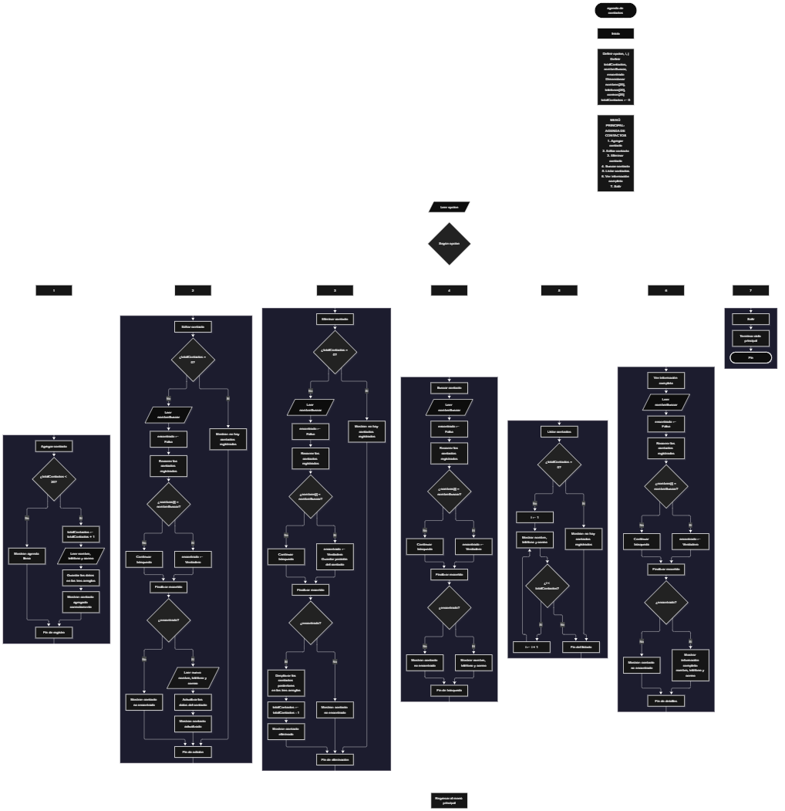

Este proyecto, llamado <b>agenda de contactos</b>, fue desarrollado en <b>pseint</b> como un ejercicio práctico para fortalecer la lógica de programación mediante la creación de un sistema de gestión de contactos desde la consola. El programa cuenta con un menú principal de siete opciones que permite <b>agregar, editar, eliminar, buscar, listar y consultar la información completa</b> de los contactos registrados. Cada contacto almacena datos como el nombre, el teléfono y el correo electrónico, utilizando arreglos con una capacidad máxima de <b>20 contactos durante la ejecución</b>. Durante su desarrollo se aplicaron conceptos fundamentales de programación, como variables, arreglos, estructuras condicionales, ciclos repetitivos y estructuras de selección, además de procesos para buscar, modificar, eliminar y organizar registros. Este proyecto permite poner en práctica los conocimientos adquiridos en PSeInt y sirve como base para desarrollar sistemas de gestión más avanzados utilizando otros lenguajes y tecnologías.

<h2 align="center">⚙️ Funcionamiento del menú principal</h2>

### ➕ Agregar contacto

La opción <b>1) agregar contacto</b> permite registrar una nueva persona en la agenda. Antes de realizar el registro, el sistema comprueba que la cantidad de contactos almacenados sea menor a <b>20</b>, utilizando la condición <b>totalcontactos &lt; 20</b>. Si existe espacio disponible, la variable <b>totalcontactos</b> aumenta en uno y el programa solicita el <b>nombre, teléfono y correo electrónico</b> del contacto. Los datos se almacenan en la posición correspondiente de sus respectivos arreglos. Finalmente, muestra el mensaje <b>"contacto agregado correctamente."</b>. Si la agenda alcanza su capacidad máxima, presenta los mensajes <b>"la agenda está llena."</b> y <b>"no es posible agregar más contactos."</b>, impidiendo registrar otro contacto.

### ✏️ Editar contacto

La opción <b>2) editar contacto</b> permite modificar la información de un contacto registrado. Primero, el programa comprueba si existen contactos almacenados mediante la variable <b>totalcontactos</b>. Si no hay registros, muestra el mensaje <b>"no hay contactos registrados."</b>. En caso contrario, presenta una lista con el número, nombre, teléfono y correo electrónico de cada contacto. Después, solicita el número del contacto que se desea editar y comprueba que esté dentro del rango permitido mediante la condición <b>i &gt;= 1 y i &lt;= totalcontactos</b>. Si la selección es válida, muestra la información actual y solicita el nuevo nombre, teléfono y correo electrónico, actualizando directamente los valores de los arreglos correspondientes. Finalmente, presenta el mensaje <b>"contacto editado correctamente."</b>. Si el número seleccionado no corresponde a un contacto registrado, informa que el contacto seleccionado no existe.

### 🗑️ Eliminar contacto

La opción <b>3) eliminar contacto</b> permite eliminar un contacto registrado mediante su número dentro de la lista. Antes de comenzar, el programa comprueba que existan contactos almacenados. Si la agenda está vacía, muestra el mensaje <b>"no hay contactos registrados."</b>. Si hay registros disponibles, presenta una lista con el nombre, teléfono y correo electrónico de cada contacto. Después, solicita el número del contacto que se desea eliminar y verifica que la selección esté dentro del rango válido. Si el contacto existe, muestra sus datos y comienza el proceso de eliminación. Para mantener los registros organizados, utiliza un ciclo <b>para</b> controlado por la variable <b>j</b>, que desplaza una posición hacia atrás los datos de los contactos posteriores en los arreglos <b>nombres, telefonos y correos</b>. Posteriormente, limpia la última posición ocupada, disminuye la variable <b>totalcontactos</b> en uno y muestra el mensaje <b>"contacto eliminado correctamente."</b>. Si el número seleccionado no corresponde a un contacto registrado, informa que el contacto seleccionado no existe.

### 🔎 Buscar contacto

La opción <b>4) buscar contacto</b> permite localizar un contacto mediante su nombre. Primero, el programa comprueba si existen contactos registrados. Si la agenda está vacía, muestra el mensaje <b>"no hay contactos registrados."</b>. En caso contrario, inicializa la variable lógica <b>encontrado</b> con el valor <b>falso</b> y solicita el nombre del contacto que se desea buscar. A continuación, utiliza un ciclo <b>para</b> para recorrer los nombres almacenados y compararlos con el valor introducido mediante la condición <b>nombres[i] = nombrebuscar</b>. Cuando encuentra una coincidencia, cambia la variable <b>encontrado</b> a <b>verdadero</b> y muestra el nombre, teléfono y correo electrónico del contacto. Si finaliza el recorrido sin encontrar coincidencias, presenta el mensaje <b>"no se encontró ningún contacto con ese nombre."</b>. La búsqueda compara el nombre introducido con los nombres almacenados.

### 📋 Listar contactos

La opción <b>5) listar contactos</b> permite visualizar todos los contactos registrados actualmente en la agenda. Antes de mostrar la información, el programa comprueba si la variable <b>totalcontactos</b> es igual a cero. Si no existen registros, presenta el mensaje <b>"no hay contactos registrados."</b>. Si hay contactos disponibles, utiliza un ciclo <b>para</b> para recorrer los arreglos desde la primera posición hasta el número total de contactos registrados. Durante el recorrido, muestra el número de contacto, el nombre, el teléfono y el correo electrónico de cada persona. Al finalizar, presenta el total de contactos almacenados. Esta función facilita consultar los registros existentes sin necesidad de buscar cada contacto individualmente.

### 📄 Ver información completa

La opción <b>6) ver información completa</b> permite consultar todos los datos de un contacto específico. Primero, el programa comprueba si existen contactos registrados. Si la agenda está vacía, muestra el mensaje <b>"no hay contactos registrados."</b>. En caso contrario, presenta una lista con los números y nombres de los contactos para facilitar su identificación. Después, solicita el número del contacto que se desea consultar y verifica que esté dentro del rango válido. Si la selección es correcta, muestra los datos completos del contacto: <b>nombre, teléfono y correo electrónico</b>. Si el número introducido no corresponde a ningún contacto registrado, presenta el mensaje <b>"el contacto seleccionado no existe."</b>.

### 🚪 Salir del menú principal

La opción <b>7) salir</b> está destinada a finalizar la ejecución del programa y muestra el mensaje <b>"hasta pronto."</b>. El menú principal se encuentra dentro de una estructura repetitiva <b>repetir ... hasta que</b>, que mantiene el programa en funcionamiento mientras se realizan las operaciones disponibles. Sin embargo, en el código actual, la condición final es <b>hasta que opcion = 0</b>, mientras que la opción de salida está definida con el número <b>7</b>. Por este motivo, seleccionar la opción 7 muestra el mensaje de despedida, pero no finaliza el ciclo. Esta diferencia debe corregirse para que el funcionamiento coincida con las opciones presentadas.

<h2 align="center">🧠 Temas aplicados en el proyecto</h2>

### 📦 Variables

En este proyecto se utilizan variables para guardar la opción seleccionada en el menú, controlar la cantidad de contactos registrados, recorrer los arreglos, seleccionar los contactos que se desean editar, eliminar o consultar, almacenar el nombre que se desea buscar y comprobar si se encontró una coincidencia. Cada variable cumple una función específica dentro de las operaciones de gestión de contactos.

🔢 **Opcion:** Almacena la opción seleccionada por el usuario en el menú principal.

📊 **TotalContactos:** Almacena la cantidad actual de contactos registrados.

🔄 **I:** Funciona como contador en los ciclos <b>para</b> y permite seleccionar la posición de un contacto.

🔁 **J:** Controla el recorrido utilizado para desplazar los datos durante la eliminación de un contacto.

🔎 **NombreBuscar:** Almacena el nombre introducido por el usuario para realizar la búsqueda.

✅ **Encontrado:** Variable lógica que indica si se encontró un contacto con el nombre solicitado.

### 🗃️ Arreglos

En este proyecto se utilizan tres arreglos relacionados con los datos de cada contacto. Cada arreglo tiene una capacidad de <b>20 posiciones</b> y utiliza el mismo índice para representar la información correspondiente a una misma persona. Por ejemplo, los datos de un contacto almacenado en la posición <b>1</b> se encuentran distribuidos entre <b>nombres[1], telefonos[1] y correos[1]</b>. Esta organización permite recorrer, buscar, modificar, mostrar y eliminar los contactos de manera ordenada.

📝 **Nombres[20]:** Almacena los nombres de los contactos registrados.

📞 **Telefonos[20]:** Almacena los números de teléfono de los contactos.

📧 **Correos[20]:** Almacena las direcciones de correo electrónico de los contactos.

### 🔀 Estructuras condicionales

En este proyecto se utilizan las estructuras <b>si</b> y <b>sino</b> para comprobar si la agenda dispone de espacio antes de agregar un contacto, verificar si existen registros antes de realizar determinadas operaciones, validar el número seleccionado para editar, eliminar o consultar un contacto y determinar si se encontró el nombre buscado. Estas condiciones permiten que el programa responda de manera diferente según el estado de la agenda y el resultado de cada operación.

### 🔄 Estructuras repetitivas

En este proyecto se utilizan los ciclos <b>para</b> y <b>repetir ... hasta que</b>. Los ciclos <b>para</b> permiten recorrer los arreglos para mostrar los contactos, buscar nombres y acceder a los registros seleccionados. Durante la eliminación, también se utilizan para desplazar los datos de los contactos posteriores una posición hacia atrás. Por otro lado, el ciclo <b>repetir ... hasta que</b> mantiene activo el menú principal para que el usuario pueda ejecutar diferentes operaciones antes de salir del programa.

### 🎯 Estructura según

El programa evalúa el valor almacenado en la variable <b>opcion</b> y ejecuta el bloque de instrucciones correspondiente. Cada caso representa una operación específica del sistema: <b>agregar, editar, eliminar, buscar, listar, ver información completa o salir</b>. También se utiliza el bloque <b>de otro modo</b> para mostrar el mensaje <b>"opción inválida."</b> cuando el valor introducido no coincide con ninguna de las opciones definidas.

### 🔢 Dimensionamiento de arreglos

El programa utiliza la instrucción <b>dimension</b> para establecer la capacidad de los arreglos que almacenan la información de los contactos. Se definieron <b>20 posiciones</b> para cada arreglo, lo que permite administrar hasta 20 contactos durante la ejecución. La cantidad de posiciones ocupadas se controla mediante la variable <b>totalcontactos</b>, por lo que las operaciones recorren únicamente los registros comprendidos entre la primera posición y el total actual de contactos.

### 🔄 Reorganización de registros

Cuando se selecciona un contacto para eliminarlo, el programa utiliza un ciclo <b>para</b> que comienza en la posición seleccionada y llega hasta <b>totalcontactos - 1</b>. En cada repetición, los datos de la posición siguiente se copian sobre la posición actual en los tres arreglos: <b>nombres, telefonos y correos</b>. Después, se limpian los datos de la última posición ocupada y la variable <b>totalcontactos</b> disminuye en uno. De esta manera, los contactos posteriores ocupan las posiciones disponibles sin dejar espacios vacíos entre los registros activos.

<h2 align="center">¿Cómo se implementaron las operaciones crud en el proyecto?</h2>

Las operaciones <b>crud</b> se implementaron mediante las opciones del menú principal, permitiendo administrar los contactos registrados. La operación <b>crear</b> corresponde a <b>agregar contacto</b>, donde se introducen los datos de una nueva persona; <b>leer</b> se realiza mediante las opciones <b>buscar contacto, listar contactos y ver información completa</b>; <b>actualizar</b> corresponde a <b>editar contacto</b>, donde se modifican los datos de una persona registrada; y <b>eliminar</b> se realiza mediante la opción <b>eliminar contacto</b>. Estas operaciones utilizan variables, arreglos, condicionales y ciclos para gestionar la información almacenada temporalmente durante la ejecución del programa.

<h2 align="center">Diagrama de flujo del proyecto</h2>

<h2 align="center">🛡️ Validaciones del programa</h2>

### 📭 No existen contactos registrados

Esta validación se utiliza en las opciones de <b>editar, eliminar, buscar, listar y ver información completa</b>. El programa comprueba si la variable <b>totalcontactos</b> es igual a <b>0</b> y, si no existen contactos registrados, muestra el mensaje <b>"no hay contactos registrados."</b>. Esta comprobación evita continuar con las operaciones que necesitan información almacenada cuando la agenda está vacía.

### ⚠️ Agenda llena

Esta validación se utiliza durante el registro de nuevos contactos para controlar la capacidad máxima de los arreglos. El programa comprueba si <b>totalcontactos &lt; 20</b> antes de permitir agregar un nuevo registro. Si existe espacio disponible, aumenta el contador y solicita los datos del contacto. En caso contrario, muestra los mensajes <b>"la agenda está llena."</b> y <b>"no es posible agregar más contactos."</b>, impidiendo registrar más contactos mientras se mantenga la capacidad máxima.

### ❌ Contacto no encontrado

Esta validación se utiliza durante la búsqueda de contactos. El programa inicializa la variable lógica <b>encontrado</b> con el valor <b>falso</b> y recorre el arreglo <b>nombres</b> para comparar cada nombre con el valor introducido por el usuario. Cuando encuentra una coincidencia, cambia la variable a <b>verdadero</b> y muestra la información del contacto. Si al finalizar el recorrido la variable <b>encontrado</b> continúa siendo <b>falso</b>, muestra el mensaje <b>"no se encontró ningún contacto con ese nombre."</b>. En las operaciones de edición, eliminación y consulta de información completa, el programa también verifica que el número seleccionado corresponda a un contacto existente.

### 🔢 Selección de contactos

El programa utiliza la variable <b>i</b> para identificar la posición del contacto que se desea editar, eliminar o consultar. Antes de realizar estas operaciones, comprueba que el número introducido sea mayor o igual a <b>1</b> y menor o igual al valor de <b>totalcontactos</b>. Si la selección está fuera de ese rango, muestra el mensaje <b>"el contacto seleccionado no existe."</b>. Esta validación evita modificar, eliminar o consultar posiciones que no corresponden a contactos registrados.

### ⚠️ Opción inválida

La estructura <b>segun</b> incluye el bloque <b>de otro modo</b>, que muestra el mensaje <b>"opción inválida."</b> cuando el usuario introduce un número que no corresponde a ninguna de las opciones definidas en el menú. Sin embargo, la condición de salida del ciclo utiliza el valor <b>0</b>, mientras que el menú presenta la opción <b>7</b> para salir. Esta diferencia hace que la opción de salida no termine el ciclo como se espera.

<h2 align="center">🎯 Objetivo del proyecto</h2>

El objetivo principal de este proyecto es fortalecer la <b>lógica de programación</b> mediante el desarrollo de un sistema de gestión de contactos en <b>pseint</b>. A través de su construcción se busca aplicar los conocimientos adquiridos sobre variables, arreglos, estructuras condicionales, ciclos repetitivos y estructuras de selección, integrándolos para resolver un problema de manera organizada. Además, el proyecto permite comprender cómo registrar, consultar, modificar y eliminar información en una aplicación de consola, estableciendo una base para desarrollar sistemas de gestión más completos con otros lenguajes y tecnologías.

