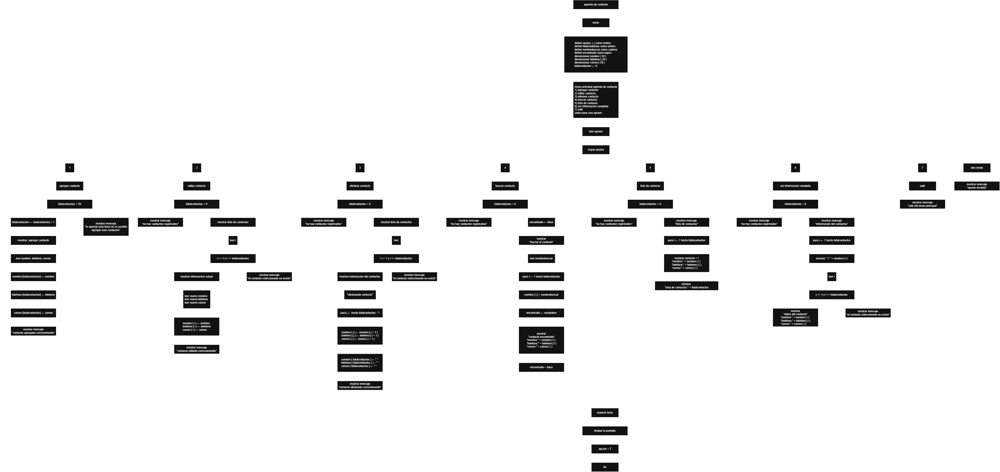

 

Este proyecto, llamado <b>agenda de contactos</b>, fue desarrollado en <b>pseint</b> como un ejercicio práctico para fortalecer la lógica de programación mediante la creación de un sistema de gestión de contactos desde la consola. El programa permite <b>agregar, editar, eliminar, buscar, listar y consultar información completa</b> de los contactos registrados, almacenando datos como el nombre, teléfono y correo electrónico. Durante su desarrollo se aplicaron conceptos fundamentales como <b>variables, arreglos, estructuras condicionales, ciclos repetitivos y estructuras de selección</b>, además de procesos de búsqueda, modificación, eliminación y reorganización de registros. El proyecto busca poner en práctica estos conocimientos y servir como base para desarrollar versiones más avanzadas utilizando otros lenguajes y tecnologías.

<h2 align="center">📖 Explicación del proyecto</h2>

<strong>Agenda de Contactos</strong> es un programa de consola que permite administrar contactos mediante un menú principal con siete opciones. Cada contacto registrado contiene información como el <b>nombre, teléfono y correo electrónico</b>, cuyos datos se almacenan temporalmente mediante tres <strong>arreglos</strong>. El programa tiene una capacidad máxima de <strong>20 contactos</strong> durante la ejecución y permite realizar diferentes operaciones para gestionar los registros de manera organizada. Además, incorpora comprobaciones para evitar agregar contactos cuando la agenda está llena y para impedir determinadas operaciones cuando no existen contactos registrados.

### ➕ Agregar contacto

La opción <b>1) agregar contacto</b> permite registrar un nuevo contacto en el programa. Antes de realizar el registro, el sistema comprueba que la cantidad de contactos almacenados sea menor a <b>20</b>, utilizando la condición <b>totalcontactos &lt; 20</b>. Si existe espacio disponible, el contador <b>totalcontactos</b> aumenta en uno y el programa solicita al usuario el <b>nombre, teléfono y correo electrónico</b> del nuevo contacto. Los datos se almacenan en la posición correspondiente de los arreglos <b>nombres, telefonos y correos</b>. Finalmente, el programa muestra un mensaje indicando que el contacto fue agregado correctamente. Si la agenda alcanza su capacidad máxima, el sistema informa que está llena e impide registrar más contactos.

### ✏️ Editar contacto

La opción <b>2) editar contacto</b> permite modificar la información de un contacto que ya se encuentra registrado. Primero, el programa comprueba si existen contactos almacenados mediante la variable <b>totalContactos</b>. Si hay registros disponibles, muestra una lista numerada con el <b>nombre, teléfono y correo electrónico</b> de cada contacto. Posteriormente, el usuario debe seleccionar el número correspondiente al contacto que desea editar. El programa comprueba que la posición seleccionada esté dentro del rango válido, desde <b>1 hasta totalcontactos</b>. Si la selección es correcta, muestra la información actual y solicita el nuevo nombre, teléfono y correo electrónico. Los datos se actualizan directamente en los arreglos y se muestra un mensaje indicando que el contacto fue editado correctamente. Si la posición no existe, el programa informa que el contacto seleccionado no existe.

### 🗑️ Eliminar contacto

La opción <b>3) eliminar contacto</b> permite eliminar un contacto registrado mediante la selección de su número en la lista. Antes de comenzar, el programa verifica que existan contactos registrados. Después, muestra los contactos disponibles con sus nombres, teléfonos y correos electrónicos para facilitar la selección del registro que se desea eliminar. El usuario introduce el número del contacto y el programa comprueba que la posición seleccionada sea válida. Si el contacto existe, muestra sus datos y comienza el proceso de eliminación. Para mantener los arreglos organizados, utiliza el ciclo <b>para</b> controlado por la variable <b>j</b>, que desplaza los datos de los contactos posteriores una posición hacia atrás. Después, limpia la última posición de los tres arreglos y disminuye el valor de <b>totalcontactos</b> en uno. Finalmente, muestra un mensaje indicando que el contacto fue eliminado correctamente.

### 🔎 Buscar contacto

La opción <b>4) buscar contacto</b> permite localizar contactos registrados mediante su <b>nombre</b>. Primero, el programa verifica que existan contactos en la agenda. Si hay registros disponibles, establece la variable lógica <b>encontrado</b> en <b>falso</b> y solicita el nombre del contacto que se desea buscar. A continuación, utiliza un ciclo <b>para</b> para recorrer los nombres almacenados y comparar cada uno con el texto ingresado mediante la condición <b>nombres[i] = nombrebuscar</b>. Cuando encuentra una coincidencia, cambia el valor de <b>encontrado</b> a <b>verdadero</b> y muestra el nombre, teléfono y correo electrónico del contacto. El recorrido permite mostrar todos los contactos que coincidan exactamente con el nombre introducido. Si no encuentra ninguna coincidencia, el programa informa que no se encontró ningún contacto con ese nombre.

### 📋 Listar contactos

La opción <b>5) listar contactos</b> permite visualizar todos los contactos registrados actualmente en el programa. Antes de mostrar la información, el sistema comprueba si existen registros. Si la agenda contiene contactos, muestra el título correspondiente y recorre los arreglos mediante un ciclo <b>para</b>, desde la primera posición hasta el valor actual de <b>totalcontactos</b>. Durante el recorrido, presenta el número del contacto y sus datos organizados en <b>nombre, teléfono y correo electrónico</b>. Al finalizar, muestra el <b>total de contactos</b> registrados. Esta función facilita consultar la información almacenada sin tener que buscar cada contacto individualmente.

### 📄 Ver información completa

La opción <b>6) ver información completa</b> permite consultar individualmente los datos de un contacto registrado. Primero, el programa comprueba que existan contactos almacenados. Si hay registros disponibles, muestra una lista numerada con los nombres de todos los contactos. Posteriormente, el usuario debe seleccionar el número del contacto que desea consultar. El programa verifica que la posición se encuentre dentro del rango válido y, si la selección es correcta, muestra la información completa del registro: <b>nombre, teléfono y correo electrónico</b>. Si el número introducido no corresponde a un contacto registrado, el sistema muestra un mensaje indicando que el contacto seleccionado no existe.

### 🚪 Salir del menú principal

La opción <b>7) salir</b> está destinada a finalizar la ejecución del programa. Cuando el usuario selecciona esta opción, el sistema muestra el mensaje <b>"hasta pronto."</b>. Sin embargo, en el código actual existe un detalle que debe corregirse: el ciclo principal termina cuando <b>opcion = 0</b>, aunque la opción de salida del menú es la número <b>7</b>. Para que el programa finalice correctamente al seleccionar la opción 7, es necesario cambiar la condición final a <b>hasta que opcion = 7</b>. Una vez corregida, el ciclo dejará de repetirse cuando el usuario seleccione la opción de salida.

<h2 align="center">🧠 Temas aplicados en el proyecto</h2>

### 📦 Variables

Las variables permiten almacenar y controlar la información necesaria para el funcionamiento del programa. En este proyecto se utilizan para registrar la opción seleccionada en el menú, controlar la cantidad de contactos, recorrer los arreglos, seleccionar registros, almacenar el nombre que se desea buscar y determinar si se encontró una coincidencia. Cada variable cumple una función específica dentro de las operaciones de gestión de contactos.

🔢 **Opcion:** Almacena la opción seleccionada por el usuario en el menú principal y permite determinar qué operación debe ejecutar el programa mediante la estructura <b>segun</b>. También se utiliza en la condición final del ciclo principal para controlar la salida del programa.

📊 **Totalcontactos:** Almacena la cantidad actual de contactos registrados. Su valor aumenta al agregar un contacto y disminuye al eliminar uno. También permite controlar la capacidad máxima de 20 contactos y determinar hasta qué posición deben recorrerse los arreglos.

🔄 **I:** Funciona como contador en los ciclos <b>para</b>. Se utiliza para recorrer los arreglos y mostrar los contactos, localizar coincidencias por nombre y seleccionar las posiciones correspondientes durante las operaciones de edición, eliminación y consulta de información.

🔁 **J:** Funciona como contador auxiliar durante la eliminación de contactos. Permite recorrer las posiciones posteriores al contacto seleccionado y desplazar sus datos una posición hacia atrás, manteniendo los arreglos organizados.

🔎 **Nombrebuscar:** Almacena el nombre introducido por el usuario durante la búsqueda. Su contenido se compara con los valores del arreglo <b>nombres</b> para identificar los contactos que coincidan con el nombre ingresado.

✅ **Encontrado:** Es una variable lógica utilizada para indicar si se encontró un contacto durante el proceso de búsqueda. Comienza con el valor <b>falso</b> y cambia a <b>verdadero</b> cuando se localiza una coincidencia.

### 🗃️ Arreglos

Los arreglos permiten almacenar temporalmente la información de los contactos durante la ejecución del programa. En este proyecto se utilizan tres arreglos relacionados con el <b>nombre, teléfono y correo electrónico</b>. Cada arreglo tiene una capacidad de <strong>20 posiciones</strong> y utiliza el mismo índice para representar los datos correspondientes a una misma persona. Por ejemplo, si un contacto se encuentra en la posición <b>1</b>, su información estará distribuida entre <b>nombres[1], telefonos[1] y correos[1]</b>. Esta organización permite recorrer, buscar, modificar, mostrar y eliminar los registros de manera ordenada.

👤 **Nombres[20]:** Almacena el nombre de cada contacto registrado. Se utiliza para identificar a las personas, mostrar las listas y realizar las búsquedas por nombre.

📞 **Telefonos[20]:** Almacena el teléfono correspondiente a cada contacto. La posición del teléfono coincide con la posición del nombre y del correo electrónico del mismo registro.

✉️ **Correos[20]:** Almacena la dirección de correo electrónico de cada contacto. Su posición coincide con los datos correspondientes en los arreglos de nombres y teléfonos.

### 🔀 Estructuras condicionales

Las estructuras condicionales <b>si</b> y <b>sino</b> permiten evaluar diferentes situaciones y determinar qué instrucciones debe ejecutar el programa. En este proyecto se utilizan para comprobar si existen contactos registrados antes de realizar determinadas operaciones, verificar que la agenda no haya alcanzado su capacidad máxima y validar que el número seleccionado corresponda a una posición existente. También se utilizan para comprobar si se encontró un contacto durante la búsqueda y determinar qué mensaje debe mostrarse según el resultado de la operación.

### 🔄 Estructuras repetitivas

Las estructuras repetitivas permiten ejecutar instrucciones varias veces para recorrer registros o mantener el programa en funcionamiento. En este proyecto se utilizan los ciclos <b>para</b> y <b>repetir ... hasta que</b>. El ciclo <b>para</b> permite recorrer los contactos almacenados para mostrarlos, buscarlos y realizar otras operaciones. Durante la eliminación, también permite desplazar los datos de los contactos posteriores para reorganizar los arreglos. Por otro lado, el ciclo <b>repetir ... hasta que</b> mantiene activo el menú principal para que el usuario pueda ejecutar diferentes operaciones antes de finalizar el programa.

### 🎯 Estructura segun

La estructura <b>segun</b> permite controlar las diferentes opciones disponibles en el menú principal. El programa evalúa el valor almacenado en la variable <b>opcion</b> y ejecuta el bloque de instrucciones correspondiente. Cada caso representa una operación específica del sistema: <b>agregar, editar, eliminar, buscar, listar, ver información completa o salir</b>. Además, se utiliza el bloque <b>de otro modo</b> para mostrar un mensaje cuando el usuario introduce una opción que no corresponde a las opciones disponibles.

### ✅ Variables lógicas

La variable lógica <b>encontrado</b> se utiliza en la búsqueda de contactos para determinar si existe una coincidencia entre el nombre ingresado y alguno de los nombres almacenados. Antes de comenzar la búsqueda, su valor se establece en <b>falso</b>. Cuando el programa encuentra un nombre que coincide con el texto introducido, cambia el valor a <b>verdadero</b> y muestra la información del contacto. Al finalizar el recorrido, comprueba si la variable continúa siendo falsa para determinar si debe informar que no encontró ningún contacto. Este proceso se realiza mediante las instrucciones <b>encontrado &lt;- falso</b> al iniciar la búsqueda y <b>encontrado &lt;- verdadero</b> al localizar una coincidencia.

### 🔢 Dimensionamiento de arreglos

El programa utiliza la instrucción <b>dimension</b> para establecer la capacidad de los arreglos que almacenan la información de los contactos. Se definieron <b>20 posiciones</b> para cada arreglo, lo que permite administrar hasta 20 contactos durante la ejecución. La cantidad de posiciones ocupadas se controla mediante la variable <b>totalcontactos</b>, por lo que las operaciones recorren únicamente los registros que se encuentran actualmente registrados.

### 🔄 Reorganización de registros

Durante la eliminación de un contacto, el programa reorganiza los arreglos para evitar dejar espacios vacíos entre los registros activos. Cuando se selecciona un contacto válido, el ciclo controlado por <b>j</b> copia los datos de la posición siguiente sobre la posición actual. Este proceso se repite hasta desplazar los contactos posteriores una posición hacia atrás. Después, se limpian los datos de la última posición utilizada y se disminuye el contador <b>totalContactos</b> en uno. De esta manera, los contactos restantes permanecen organizados de forma consecutiva.

<h2 align="center">¿Cómo se implementaron las operaciones crud en el proyecto?</h2>

Las operaciones <b>crud</b> se implementaron mediante las opciones del menú principal, permitiendo administrar los contactos registrados. La operación <b>crear</b> corresponde a <b>agregar contacto</b>, donde se registran nuevos datos; <b>leer</b> se realiza mediante las opciones <b>buscar contacto, listar contactos y ver información completa</b>; <b>actualizar</b> corresponde a <b>editar contacto</b>; y <b>eliminar</b> se realiza mediante la opción <b>eliminar contacto</b>. Estas operaciones utilizan variables, arreglos, condicionales y ciclos para gestionar la información durante la ejecución del programa.

<h2 align="center">Diagrama de flujo del proyecto</h2>

<h2 align="center">🛡️ Validaciones del programa</h2>

El programa incorpora diferentes validaciones para controlar situaciones que pueden ocurrir durante su ejecución. Estas comprobaciones permiten evitar el registro de contactos cuando la agenda está llena, impedir operaciones cuando no existen contactos registrados y comprobar que la posición seleccionada corresponda a un contacto existente. También se utiliza una variable lógica para determinar si se encontró un contacto durante la búsqueda. Estas validaciones ayudan a mantener un funcionamiento organizado y a proporcionar mensajes informativos al usuario.

### 📭 No existen contactos registrados

Esta validación se utiliza cuando el usuario intenta realizar una operación y todavía no existen contactos registrados. El programa comprueba si la variable <b>totalContactos</b> es igual a <b>0</b> y, en ese caso, evita continuar con la operación y muestra el mensaje <b>"no hay contactos registrados."</b>. Esta comprobación se aplica en las opciones de <b>editar, eliminar, buscar, listar y ver información completa</b>.

### ⚠️ Agenda llena

Esta validación se utiliza durante el registro de nuevos contactos para controlar la capacidad máxima de los arreglos. El programa comprueba si <b>totalContactos &lt; 20</b> antes de permitir agregar un nuevo registro. Si todavía existe espacio disponible, el contacto puede registrarse normalmente. En caso contrario, el sistema muestra los mensajes <b>"la agenda esta llena."</b> y <b>"no es posible agregar mas contactos."</b>, impidiendo agregar más contactos.

### ❌ Contacto no encontrado

Esta validación se aplica cuando el usuario intenta buscar un contacto y el nombre introducido no coincide con ninguno de los nombres almacenados. El programa utiliza la variable lógica <b>encontrado</b> para comprobar el resultado de la búsqueda. Si después de recorrer los registros su valor continúa siendo <b>falso</b>, muestra el mensaje <b>"no se encontro ningun contacto con ese nombre."</b>.

### 🔢 Número de contacto inválido

Esta validación se utiliza cuando el usuario selecciona un número para editar, eliminar o consultar un contacto. El programa comprueba que el valor introducido sea mayor o igual a <b>1</b> y menor o igual a <b>totalContactos</b>. Si la posición está dentro de ese rango, permite continuar con la operación. De lo contrario, muestra el mensaje <b>"el contacto seleccionado no existe."</b>. Esta comprobación evita realizar las operaciones sobre posiciones que no corresponden a contactos registrados.

### ⚠️ Opción inválida

Esta validación controla las opciones introducidas en el menú principal. Cuando el usuario selecciona un número que no corresponde a ninguno de los casos definidos en la estructura <b>segun</b>, se ejecuta el bloque <b>de otro modo</b> y se muestra el mensaje <b>"opcion invalida."</b>. De esta manera, el programa informa al usuario que debe seleccionar una de las opciones disponibles.

### 🔍 Coincidencia exacta en la búsqueda

La búsqueda compara el nombre ingresado con los nombres almacenados mediante una igualdad directa. Por este motivo, el texto debe coincidir con el nombre registrado para que el contacto sea localizado. El programa actual no incorpora una búsqueda parcial ni una función específica para ignorar diferencias entre mayúsculas y minúsculas. Esta característica corresponde al funcionamiento actual del código.

<h2 align="center">🎯 Objetivo del proyecto</h2>

El objetivo principal de este proyecto es fortalecer la <b>lógica de programación</b> mediante la construcción de un sistema funcional para la gestión de contactos en <b>PSeInt</b>. A través de su desarrollo se busca aplicar los conocimientos adquiridos sobre variables, arreglos, estructuras condicionales, ciclos y operaciones <b>crud</b>, utilizándolos de manera conjunta para resolver un problema de forma organizada. Además, el proyecto permite comprender cómo se pueden registrar, consultar, modificar y eliminar datos dentro de una aplicación de consola, estableciendo una base para desarrollar sistemas de gestión más completos con otros lenguajes de programación y tecnologías.

<h2 align="center">¿Qué aprendizajes se obtuvieron durante el desarrollo del proyecto?</h2>

Durante el desarrollo de este proyecto se fortalecieron conocimientos relacionados con la <b>lógica de programación</b> y la construcción de aplicaciones de consola en <b>pseint</b>. La implementación de la Agenda de Contactos permitió poner en práctica diferentes estructuras y técnicas para administrar información, resolver problemas de forma organizada y comprender cómo se combinan distintos conceptos de programación para construir una aplicación funcional. Entre los principales aprendizajes obtenidos se encuentran:

* Declarar y utilizar variables de diferentes tipos de datos.
* Trabajar con arreglos y relacionar información mediante sus posiciones.
* Registrar contactos utilizando una cantidad máxima de posiciones.
* Recorrer y mostrar información almacenada mediante ciclos.
* Buscar contactos utilizando coincidencias entre cadenas de texto.
* Modificar los datos de un contacto existente.
* Eliminar registros y reorganizar sus posiciones en los arreglos.
* Utilizar variables contadoras para controlar la cantidad de registros.
* Aplicar estructuras condicionales para validar diferentes situaciones.
* Crear menús interactivos mediante estructuras de selección.
* Utilizar ciclos repetitivos para mantener el programa en funcionamiento.
* Aplicar operaciones crud para administrar los contactos.
* Implementar validaciones para controlar registros inexistentes y opciones inválidas.
* Comprender la importancia de mantener organizados los arreglos después de eliminar información.

